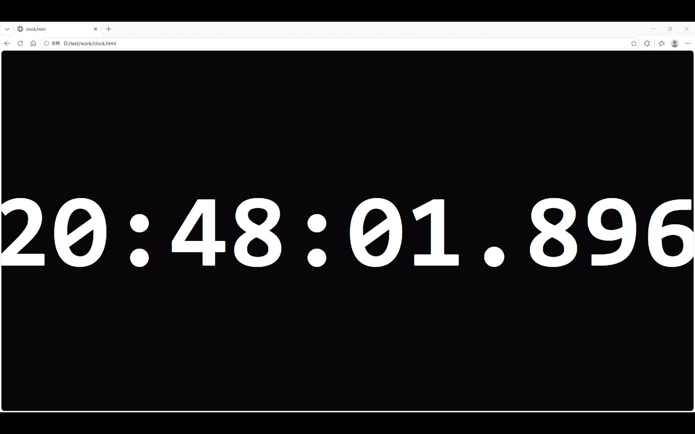
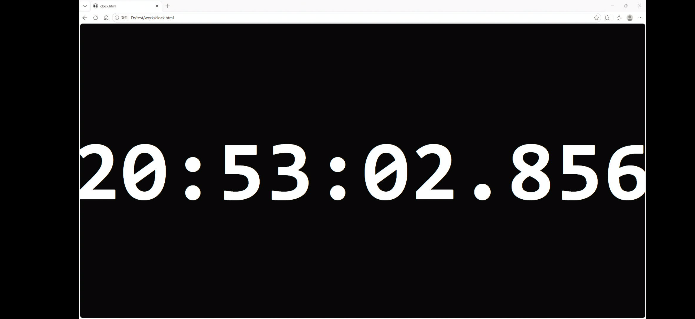

# TideCapture（潮汐捕获）

> 开源 UVC 采集卡手机监看工具 —— 把 USB 采集卡的 HDMI 输入铺满手机/平板屏幕当副屏。
>
> **用途**：给树莓派等开发板的低成本屏幕方案 —— 开发板 HDMI 输出接采集卡，采集卡插进手机 / 平板，
> 手上任何一台闲置手机就是它的显示器，不用另买一块屏，也不用为了看一眼启动日志去搬显示器。

无广告、无联网、无录像推流，**762 KB**。以 **GPL-3.0** 开源，**禁止倒卖**。

## 截图

| 平板（Mi Pad 4，1920×1200） | 手机A（3136×1440，16:9 源左右留黑边） |
|---|---|
|  |  |

## 这一版做了什么

解码和上色两头一起砍：

- **解码**：`uvc_mjpeg2yuyv`（libuvc 的 libjpeg raw 输出 + YUYV 交错重排）换成 TurboJPEG 的
  `tjDecompressToYUV2`，直接解成 Y / U / V 三个平面（4:2:2 源 → Y 1920×1080，U/V 960×1080），
  **不再按 YUYV 交错重排**。
- **上色**：YUV→RGB 搬进 fragment shader，CPU 完全不碰像素。U/V 平面比 Y 小一圈，但归一化纹理
  坐标是同一套，`GL_LINEAR` 顺带把色度上采样做掉了——连「上采样」这一趟内存搬运也不需要。
- **tjhandle 只用一次**：libuvc 每帧都 `tjInitDecompress`/`tjDestroy`，这里复用。
- **静止画面直接跳过**：采集卡对静态画面输出的 JPEG 字节完全相同，逐字节比对一致就既不解码
  也不上传（副屏看文档/桌面时 CPU 占用可降到 ~0）。

## 对比：本版 vs 某软件

只拿**当前这一版**和**某商业副屏软件**（下称「某软件」）比，不拉历史版本和其他方案进来。

| 维度 | **本版 TideCapture** | **某软件** |
|---|---|---|
| 机制 | HDMI → 采集卡 → USB → 手机解码上屏 | PC 端软件抓屏 → 软件编码 → USB/网络 → 手机解码 |
| PC 端要装什么 | **什么都不用装**，PC 只当信号源 | 要装客户端，通常还要配虚拟显示器驱动 |
| 手机端 | 一个 APK，走本地 USB | 要配对，多数方案依赖局域网 |
| 画面被编码几次 | **1 次**，采集卡内 MJPEG 硬件编码，无二次压缩 | 至少 1 次软件编码，常见二次压缩 |
| 延迟 | **47 ms**（PC 软件提交翻色 → 手机解出这一帧），玻璃→玻璃 60~90 ms | **约 77 ms**（同法实测，比本版慢约 30 ms） |
| 帧率 | **1080p50**，吃满采集卡 1080p 档位上限 | 1920×1080 MJPEG（App 自报），跑多少帧没测 |
| 画质 | 受采集卡 MJPEG 限制，但只压一次 | 码率可调，通常更低码率换带宽 |
| 连线 | 需要 **HDMI 线 + 采集卡** | 一根 USB 线或同网即可，**不用 HDMI** |
| 广告 / 账号 / 订阅 | **无**，不联网 | 常见 |
| 能不能改 | **GPL-3.0，源码全在** | 闭源 |
| 成本 | 一次性买张采集卡 | 订阅或买断 |
| 典型场景 | 树莓派/开发板的随身屏、台式机旁边的副屏、看文档调机 | 笔记本 ↔ 平板互当副屏，位置自由 |

### 和某软件的实测对比（同一套 500 ms 翻色法）

第三方 App 没法在它进程里打点，所以改用「PC 显示毫秒时钟 → 手机截图 → 读屏上时钟」：

1. PC 端在采集卡那块屏上全屏显示 `HH:MM:SS.mmm` 的毫秒时钟（等宽字体、纯黑底白字）。
2. 手机上跑被测 App 全屏预览，`screencap` 抓帧，同时用设备时钟记下抓帧命令的起止（A、B）。
3. 屏上读到的时钟值就是「这一帧内容的时刻」；它一定落在 [A, B] 之间被抓到，于是
   `延迟 ∈ [A − 屏上时刻, B − 屏上时刻]`，多采几次取交集与中位。
4. 两端时钟用 `adb shell date +%s%N` 校正。这个校正误差对两个 App 是同一份，
   所以**两者的差值不受它影响**。

两台设备各 12 次采样（1920×1080 MJPEG，同一张卡；显示缩到 720×450 / 720×720 以减少抓帧耗时）：

| | 手机A 本版 | 手机A 某软件 | Mi Pad 4 本版 | Mi Pad 4 某软件 |
|---|---|---|---|---|
| A − 屏上时刻（中位） | −13.0 ms | +19.2 ms | −145.1 ms | −84.5 ms |
| B − 屏上时刻（中位） | 127.6 ms | 156.1 ms | 135.1 ms | 204.5 ms |
| 延迟区间（交集） | [1.9, 116.8] | [45.4, 136.3] | [−37.4, 123.1] | [34.1, 170.9] |
| 单次抓帧耗时 | 143 ms | 136 ms | 281 ms | 298 ms |

单次抓帧本身要 130~300 ms，所以**绝对值**的区间很宽；但同一台设备上两个 App 走的是同一套
抓帧管线，**两者的差**是可信的：

| | 中位差 | 下界差 | 结论 |
|---|---|---|---|
| 手机A（旗舰 SoC） | **+28.5 ms** | +43 ms | 某软件比本版慢约 **30 ms**，约 77 ms 出画面 |
| Mi Pad 4（SD660） | **+69.4 ms** | +71.5 ms | 某软件比本版慢约 **70 ms**，约 110~140 ms 出画面 |

也就是说：机器越弱，两者的差距越大——某软件吃的是 CPU（解码 + YUV 转换都在 CPU 上），
本版把上色丢给 GPU，同样在 SD660 上差距从 30 ms 拉到 70 ms。

### 怎么选

- 要**低延迟、不联网、PC 端零安装** → 本版。代价是要拉一根 HDMI 线、要一张采集卡、手机得有 USB 口。
- 要**无线、位置随意** → 某软件这类商业方案。代价是延迟更高、PC 端要装东西、画面要过它的编码链路。
- 两者**不是替代关系**：机制不同（硬件直采 vs 软件抓屏），按场景挑。

## 实测：1920×1080 MJPEG @50fps

本版只有这一个工作点（为什么是 50 见下一节）。logcat 每 120 帧打一行，两台机器同一条流、同一张卡：

| | 手机A | Mi Pad 4 |
|---|---|---|
| TurboJPEG 解码 | 6.0 ms | 9.7 ms |
| GL 上传 + 绘制 | 1.3 ms | 3.9 ms |
| 单帧处理合计 | **7.3 ms** | **13.5 ms** |
| 出帧间隔（50 fps） | 20 ms | 20 ms |
| 实测帧率 | **50.3 fps** | **50.1 fps** |

```
手机A     TurboJPEG+GL: decode 6.0ms upload+draw 1.3ms total 7.3ms @50.3fps
Mi Pad 4  TurboJPEG+GL: decode 9.7ms upload+draw 3.9ms total 13.5ms @50.1fps
```

两台都落在 20 ms 帧间隔之内（余量 12.7 ms / 6.5 ms），所以不积压、也不会越看越延迟。
Mi Pad 4 那组是在显示缩到 720×450 时采的，原生分辨率下解码耗时不变、绘制会更贵一些。

手机A 的屏幕是 3136×1440（2.18:1），源是 16:9，所以左右留黑边——按比例居中，没有拉伸。

**两个调度上的坑（比算法更值钱）**

1. **线程优先级**：解码 + 上传都在同一条预览线程上，默认优先级会被后台任务挤掉大核，
   decode 会从 6 ms 级抖到 20 ms 以上。`setpriority(PRIO_PROCESS, gettid(), -8)`
   （与 AudioTrack 同级）后稳定。
2. **绑最高频那一簇**：不绑核时线程会在两个簇之间飘，长时间跑会明显变慢。做法读
   `/sys/.../cpu*/cpufreq/cpuinfo_max_freq` 找最高频的核再绑：
   - SD660 → cpu4~7 @2.2 GHz
   - 旗舰大核 → cpu6~7 @4.3 GHz

   两条都失败也不影响功能，只是慢一点，所以是「尽力而为」的写法，并在 logcat 里打一行
   `pinned to top cluster: N cores (a..b) @XXXXMHz` 方便核对。

## 帧率：为什么是 50

1. **屏幕刷新率不是瓶颈。** 渲染侧 `eglSwapInterval(display, 0)`，来一帧就画一帧、不等 vsync。
2. **采集卡的档位表才是上限。** 把 UVC 描述符 dump 出来（`getSupportedSize` 现在会带 `modes`），
   某采集卡在 USB 2.0 下、1920×1080 的 MJPEG 档位是 `50/30/25/20/10`：

   | 分辨率 | MJPEG 可用帧率 |
   |---|---|
   | 1920x1080 | **50**/30/25/20/10 |

   **1080p 最高就是 50 fps，没有 60。** 这是卡固件里的档位表，不是 USB 带宽也不是手机算力
   （1440p50 = 205 Mpx/s > 1080p60 = 124 Mpx/s，带宽够，档位就是没有）。固件改不了，
   所以本版固定跑 1080p50 这一个工作点。
3. **应用请求的就是 50。** 默认直接请求卡能给的满档，不降档。

启动（默认即 1080p50，不用带参数）：

```bash
adb shell am start -n com.yi.tidecapture/.MainActivity     # 1080p + 卡能给的最高帧率（=50）
```

## 延迟实测（PC 画面 → 手机屏幕）

口径先说清楚：这里测的是 **「PC 端软件提交翻色 → 手机解出这一帧」**，不是「玻璃→玻璃」——
上游 PC 出光与下游手机合成/面板响应各差一截（约 10~16 ms 与 15~27 ms），后文按这个口径读。

### 方法（可复现）

不用高速摄像机，也不用给两端对表，只要 PC 端有一个「可判定的时刻」：

1. **PC 端制造事件。** 在那块接采集卡的屏幕上铺全屏纯色，用某软件按**绝对墙钟**每 500 ms 在
   白/黑之间翻转。翻色时刻恒落在 500 ms 的整数边界上，于是**边界本身就是时间基准**，不需要
   记录每一次翻转的时间。最小实现就是一个页面：

   ```html
   <script>
   const W = 500, box = document.getElementById('box');
   let last = -1;
   (function tick() {
     const k = Math.floor(Date.now() / W) & 1;      // 0 = 白, 1 = 黑
     if (k !== last) { last = k; box.style.background = k ? '#000' : '#fff'; }
     requestAnimationFrame(tick);
   })();
   </script>
   ```

2. **设备端只加一处打点。** MJPEG 解码完成后读画面中心像素判黑白，状态一变就打一行带
   `CLOCK_REALTIME` 的日志。纯观测、不参与渲染逻辑，测完删掉（本仓库代码里没有这段）：

   ```c
   const uint8_t yv = mDecoder->y()[(dh / 2) * dw + dw / 2];
   static int last = -1;
   const int state = (yv > 128) ? 1 : 0;               /* 1 = 黑 */
   if (state != last) {
       struct timespec ts; clock_gettime(CLOCK_REALTIME, &ts);
       LOGI("PROBE FLIP %s at %lld", state ? "BLACK" : "WHITE",
            (long long)ts.tv_sec * 1000000000LL + ts.tv_nsec);
       last = state;
   }
   ```

3. **对齐两端时钟。** `adb shell date +%s%N` 读设备时钟与 PC 时钟比，取多次采样的中位数
   （本次手机A 比 PC 慢约 1540 ms，adb 往返 66 ms）。

4. **算。** `延迟 = 设备看到翻转的时刻 − floor(该时刻 / 500 ms) × 500 ms`，多取样本看中位数，
   不看单次值（单次受帧间隔量化影响很大）。本次取 **121** 个样本（约 60 s）。

### 结果

**1920×1080 MJPEG @50 fps（n=121）**：

| 统计 | 白→黑 | 黑→白 | 合计 |
|---|---|---|---|
| 中位数 | 46.4 ms | 47.6 ms | **47.1 ms** |
| 25% / 75% | 43.3 / 48.6 | 45.3 / 50.7 | 45.3 / 50.4 |
| 最快 / 最慢 | 39.2 / 67.0 | 41.8 / 53.4 | 39.2 / 67.0 |

翻色间隔实测中位数 500.0 ms（min 482.5 / max 517.0）—— 时间戳没有累积漂移，样本可信。

这 47 ms 的构成：

| 环节 | 量级 | 来源 |
|---|---|---|
| PC 端某软件渲染一帧 + 桌面合成 + HDMI 出图 | 10 ~ 16 ms | 估计（一帧周期） |
| 采集卡 MJPEG 编码 + 一帧缓冲（50 fps → 20 ms 帧间隔） | 15 ~ 25 ms | 估计 |
| USB2 批量传输到手机 | 5 ~ 10 ms | 估计 |
| TurboJPEG 解码 | **7 ms** | 实测（logcat decode 列） |
| GL 上传 + 绘制 | **1.1 ms** | 实测（logcat upload+draw 列） |

### 误差与不确定度

这不是能给出 ±1 ms 的测量，而且**误差是带方向的**，看数字前先看这张表：

| 误差来源 | 量级 | 方向 |
|---|---|---|
| **PC 端渲染**：软件决定翻色 → 真正出光，至少 1 帧（rAF + 桌面合成） | 10 ~ 16 ms | 让测得值**偏高** |
| **帧量化**：翻色那一帧最早也要等下一个出帧间隔才被解出（50 fps → 0~20 ms） | 0 ~ 20 ms | 让测得值**偏高** |
| **时钟偏差**：adb 只能测往返，单向延迟按对称假设对半摊；RTT 66 ms，理论最坏 ±33 ms，多次采样取中位数后抖动约 ±4 ms | ±4 ~ 33 ms | 双向 |
| **时钟漂移**：两端时钟缓慢相对漂移（约 1 ms/min） | 看测量时长 | 双向，测前测后各校一次 |
| **不含上屏**：测到的是解出帧，不是屏上光子 | +15 ~ 27 ms | 相对「玻璃→玻璃」**偏低** |

结论性的说法应该是：

> 1080p50 下，**PC 软件提交翻色 → 手机解出这一帧 ≈ 47 ms，真值大概率落在 45~65 ms**；
> 换算成玻璃→玻璃约 **60~90 ms**（中位估计 ~70 ms）。

两个自检项，用来判断一批样本可不可信：

- 翻色间隔中位数 500.0 ms —— 时间戳没漂。
- 白→黑 46.4 ms、黑→白 47.6 ms 只差 1.2 ms —— 没有跟颜色相关的系统偏置（比如编码器对纯黑的
  特殊处理），这点差在误差内。

想把这个区间压到 ±5 ms 以内，只能上高速摄像机同帧拍两块屏幕，那已经超出软件测量的能力。

### 结论

换了 TurboJPEG + GL 之后，本机算力这块（7~8 ms）已经不是延迟的主项；剩下的大头是采集卡编码 /
缓冲和 PC 端出图，属于硬件和上游，改软件压不下去。

## 技术实现

```
MJPEG 帧 → tjDecompressToYUV2（Y 1920×1080 / U,V 960×1080，紧凑三平面）
        → 3 张 LUMINANCE 纹理 glTexSubImage2D（每帧 ~3MB，零 CPU 转换）
        → fragment shader：R = Y + 1.402V，G = Y − 0.344U − 0.714V，B = Y + 1.772U
        → viewport 等比缩放（居中、留黑边）
        → eglSwapBuffers（eglSwapInterval=0，不等 vsync）
```

**几个关键点：**

1. **`tjDecompressToYUV2(..., width, pad=1, height, TJFLAG_FASTDCT)`** 出来的三个平面是紧凑的
   （行尾无填充），指针就是 `buf` / `buf+Y` / `buf+Y+C`，可以原样 `glTexSubImage2D`，
   中间**一次 memcpy 都不做**。
2. **平面尺寸跟着 JPEG 自己的采样因子走**：`tjDecompressHeader3` 取 subsamp，
   `tjPlaneWidth/tjPlaneHeight` 算尺寸。采集卡是 4:2:2（U/V = w/2 × h）；换成 4:2:0 的源
   （U/V = w/2 × h/2）也不会错位——shader 里不需要知道这件事。
3. **三张纹理共用同一个 `vTex`**：归一化坐标与平面像素尺寸无关，U/V 的放大交给 `GL_LINEAR`
   插值，等于免费的色度上采样。
4. **`glPixelStorei(GL_UNPACK_ALIGNMENT, 1)`** —— U/V 平面宽度不一定是 4 的倍数。
5. **必须先 `eglMakeCurrent` 再建纹理**：预览线程第一次进来时上下文还没在当前线程生效，
   `glGenTextures` 返回 0（表现为「首帧黑一下再正常」）。
6. **纹理 Y 轴翻转**：`vTex = vec2(aPos.x, 1.0 - aPos.y)`。OpenGL 纹理原点在左下角，
   而帧数据第一行在顶部，不翻转会上下颠倒。

## 文件

```
TideCapture_v0.4.apk      ← 本版 APK（包名 com.yi.tidecapture）
shot_tjgl.png             ← 平板上的实拍（1920×1200 截屏）
shot_phone.png            ← 手机A 上的实拍（3136×1440 截屏，16:9 源左右留黑边）
src/MJpegDecoder.h/.cpp   TurboJPEG 封装：handle 复用、subsamp/平面尺寸、紧凑布局
src/GLPreview.h/.cpp      EGL + 两套 shader（YUYV / 三平面 YUV）+ 纹理管理
src/UVCPreview.h/.cpp     渲染调用点（TurboJPEG+GL 优先，逐级回退）+ 静止帧去重 + 绑核
AndroidManifest.xml       包名、USB_DEVICE_ATTACHED 自动拉起、横屏全屏
```

**已验证机器**：Mi Pad 4（Android 13，SD660）、手机A（Android 16，旗舰 SoC）。
两者都是同一个 arm64-v8a 包，绑核是运行时读 cpufreq 自动挑的，不需要分版本。

## 硬件限制

- **平板和手机的 Type-C 口都是 USB 2.0**（手机A 作为设备连电脑实测 `bcdUSB=0x0200`，
  `speed=3`/480 Mbps），所以采集卡只能跑 MJPEG 480 Mbps。
- 想再降延迟必须换承载设备（要有真 USB 3.x 口）。换了之后能走 YUY2 直通，省掉十几毫秒解码，
  端到端还能再低一截。

## 参考与引用

这个项目「能跑起来」的绝大部分都是别人的成果，本仓库只做了解码 + 上色的替换。下面按依赖关系列出：

| 项目 | 用途 | 许可 |
|---|---|---|
| [saki4510t/UVCCamera](https://github.com/saki4510t/UVCCamera) | JNI 层（`UVCPreview` / `UVCCamera`）、`USBMonitor` 等 Java 封装、构建脚本骨架。本项目的 `UVCPreview.cpp` / `GLPreview` 就是在它的 `libuvccamera` 上改的 | Apache-2.0 |
| [libuvc](https://github.com/libuvc/libuvc) | UVC 协议栈，`uvc_mjpeg2yuyv` 等转换函数 | LGPL-2.1 |
| [libusb](https://libusb.info/) | USB 传输（BULK / 等时传输、URB 管理） | LGPL-2.1 |
| [libjpeg-turbo](https://github.com/libjpeg-turbo/libjpeg-turbo) | MJPEG 解码，本项目用的是它的 TurboJPEG API（`tjDecompressToYUV2`） | IJG / BSD-3 / zlib |
| [Android NDK](https://developer.android.com/ndk) | `ndk-build` 交叉编译 | Apache-2.0 |
| [Android OpenGL ES 2.0 / EGL 文档](https://developer.android.com/develop/ui/views/graphics/opengl/about-opengl) | shader、纹理、EGL 表面管理 | - |

思路上的参考：

- YUV→RGB 的 BT.601 系数、以及「三张 `GL_LUMINANCE` 纹理 + 归一化坐标让 GPU 顺手做色度上采样」
  是移动端播放器的常见做法，本项目只是把它套到 UVC 预览上。
- 「静止帧字节级去重」来自采集卡的实际行为观察：卡对静态画面输出的 JPEG 字节逐字节相同。
- 调度那两条（`setpriority` + 按 `cpuinfo_max_freq` 绑最高频簇）是 Android 上音视频线程的通用做法。

## 第三方组件与许可

`libuvc` / `libusb` 是 **LGPL-2.1**，本项目以动态库（`.so`）形式随 APK 分发，符合 LGPL 对动态
链接的要求；如果你要改成静态链接，请自行评估许可义务。`UVCCamera` 是 Apache-2.0，保留其版权
声明即可。

本仓库自身代码以 **GPL-3.0** 发布，见根目录 `LICENSE`（含第三方库清单）。
本项目及其编译产物请勿倒卖。
